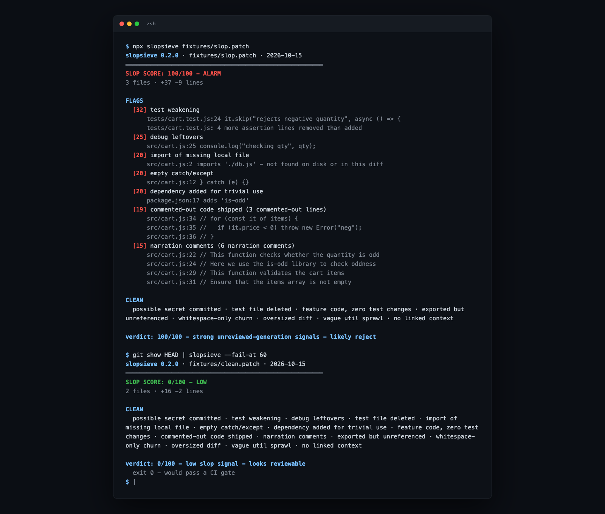

# slopsieve

**`npx slopsieve` scores a diff or PR for the slop signals maintainers check by hand - test weakening, debug leftovers, secrets, phantom imports, trivial deps. A linter for unreviewed generation.**



cURL killed its bug bounty over AI slop. Godot is drowning in it. GitHub floated a PR kill switch. The maintainers' complaint is consistent: the code *looks* fine until you actually read it. slopsieve runs the checklist a tired reviewer runs at 1am, in a second, against any diff.

## install / run

```bash
npx slopsieve owner/repo#123        # score a GitHub PR (uses gh)
npx slopsieve https://github.com/o/r/pull/123
npx slopsieve changes.diff          # score a patch file (git, diff -u, svn-style)
npx slopsieve --staged              # score staged changes
npx slopsieve main...HEAD           # score a git range
git diff main | npx slopsieve       # score stdin
```

Zero dependencies. Node 18+.

## what it flags

| signal | weight | what it catches |
|---|---|---|
| possible secret committed | 40 | `sk_live_`, `ghp_`, `AKIA`, `glpat-`, private keys, `api_key = "..."` (evidence is redacted) |
| test weakening | 30 | `it.skip`, `.only`, removed assertions, tautological `assertTrue(true)` |
| debug leftovers | 25 | `console.log`, `debugger`, `pdb.set_trace`, `binding.pry` |
| test file deleted | 25 | spec file removed while source changed (rename-aware) |
| import of missing local file | 20 | relative import that exists neither on disk nor in the diff |
| empty catch/except | 20 | `catch {}`, `catch (e) {}`, `except: pass` |
| trivial dependency | 20 | `is-odd`-class deps; net-new deps for a small diff |
| feature code, zero test changes | 15 | 150+ source lines added, not one test line touched |
| commented-out code | 15 | dead code shipped as comments (JSDoc-safe) |
| narration comments | 10 | "This function...", "Here we...", "Ensure that..." |
| exported but unreferenced | 10 | exports in new files nothing in the diff uses |
| whitespace churn | 10 | changed lines identical after whitespace normalization |
| oversized diff | 10 | >800 added lines or >15 files |
| vague util sprawl | 5 | new `utils.js`/`helpers.py` catch-alls |
| no linked context | 5 | PR body under 20 chars (gh mode) |

Lockfiles and generated files (`package-lock.json`, `*.min.js`, `dist/`, snapshots) are skipped automatically and reported as skipped.

## CI

Exit code is `1` when the score hits `--fail-at` (default 50):

```yaml
- run: gh pr diff ${{ github.event.pull_request.number }} | npx slopsieve --fail-at 60 --format github
```

`--format github` emits `::warning file=...,line=...` annotations that pin each flag onto the PR diff view. `--json` gives the same report for tooling.

Config file `.slopsieverc.json` (or `--config path`):

```json
{ "failAt": 60, "disabled": ["narration-comments"], "weights": { "secret-in-diff": 50 } }
```

## suppressions

```js
console.log(keepThis); // slopsieve-ignore: debug-leftovers
```

Inline markers suppress that check (or `slopsieve-ignore` for all) for the file containing them, eslint-disable style. `[slopsieve-ignore: check-id]` in the PR body suppresses globally.

## honest limitations

- **It is not an AI detector.** It scores diff hygiene signals. A human can write a 100/100 slop diff and an LLM can write a 0/100 clean one - the point is both deserve the same review burden.
- **Intra-diff analysis mostly.** "Exported but unreferenced" only considers new-file exports and this diff's lines; phantom-imports checks the checkout on disk, so run it in CI where the repo exists.
- **Heuristics have blind spots.** Multi-line `catch` blocks, code inside string literals (test fixtures included), and non-Latin comments can still fool it.
- **Weights are opinionated.** Tune them via `weights` in `.slopsieverc.json` rather than arguing with the defaults.

## why this exists

- [cURL scraps bug bounties over AI slop](https://reddit.com/r/programming/comments/1ql0w5p/) (2,049 upvotes of agreement)
- [Godot drowning in slop PRs](https://news.ycombinator.com/item?id=47059779)
- [GitHub ponders a PR kill switch](https://news.ycombinator.com/item?id=46884471)
- ["I won't be reviewing AI generated PRs"](https://reddit.com/r/ExperiencedDevs/comments/1towli9/) (1,922 upvotes)

## related

[mcp-bouncer](https://github.com/princejain756/mcp-bouncer) - policy enforcement at the MCP boundary · [agent-trials](https://github.com/princejain756/agent-trials) - benchmark coding agents on tasks you own

## license

MIT
